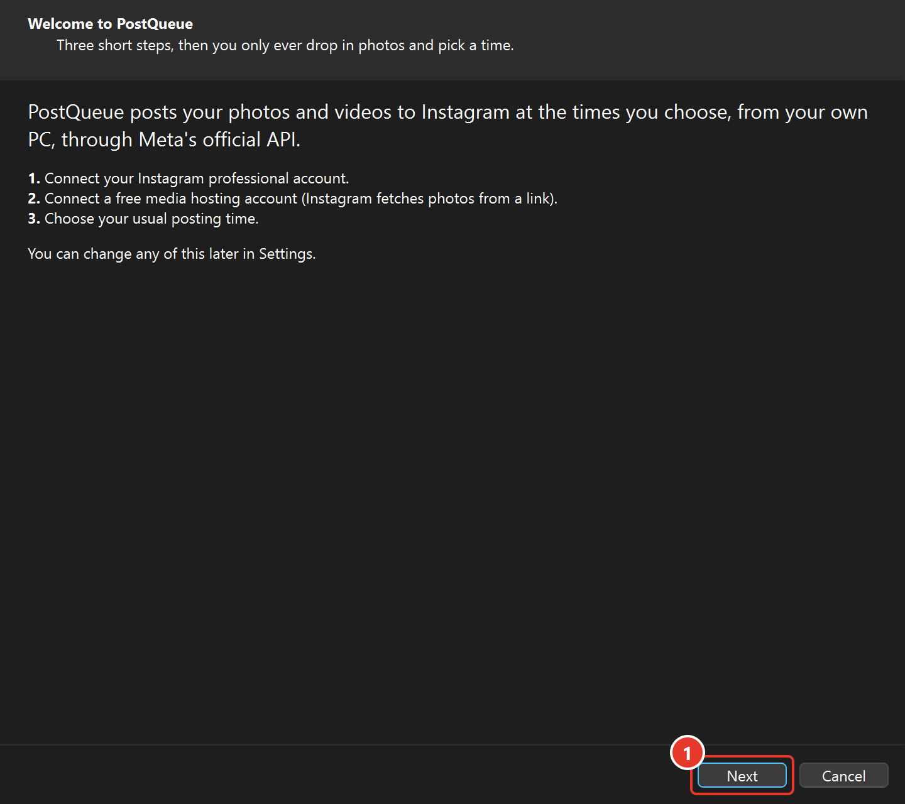
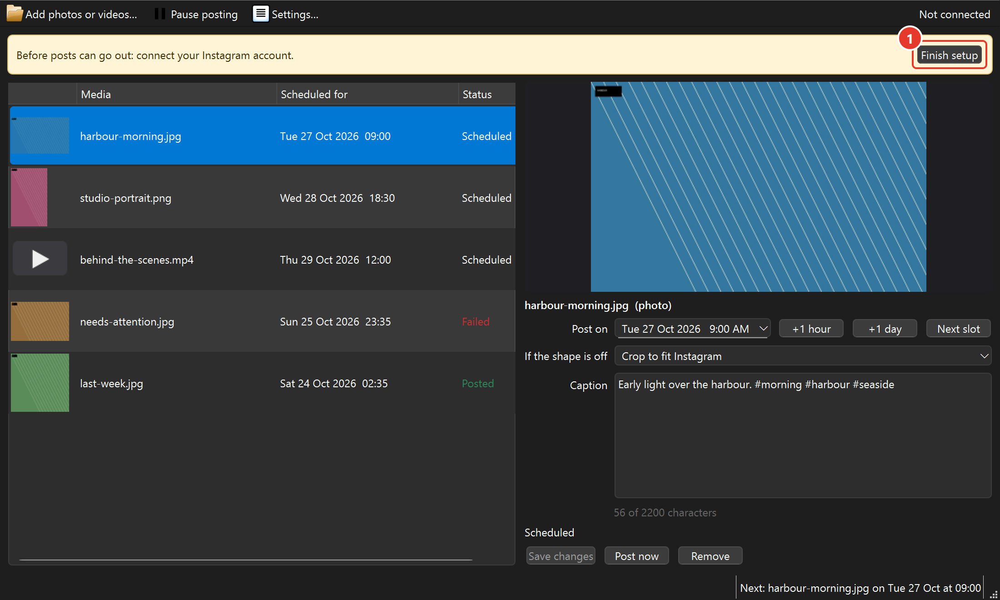
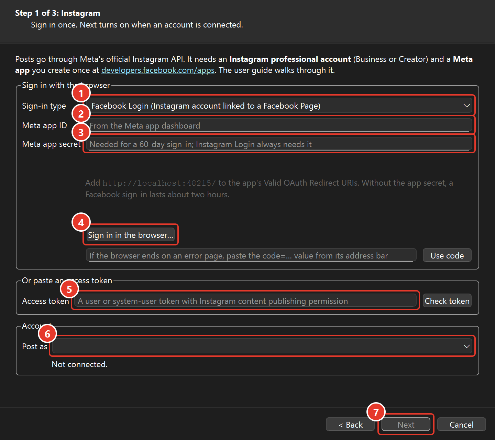
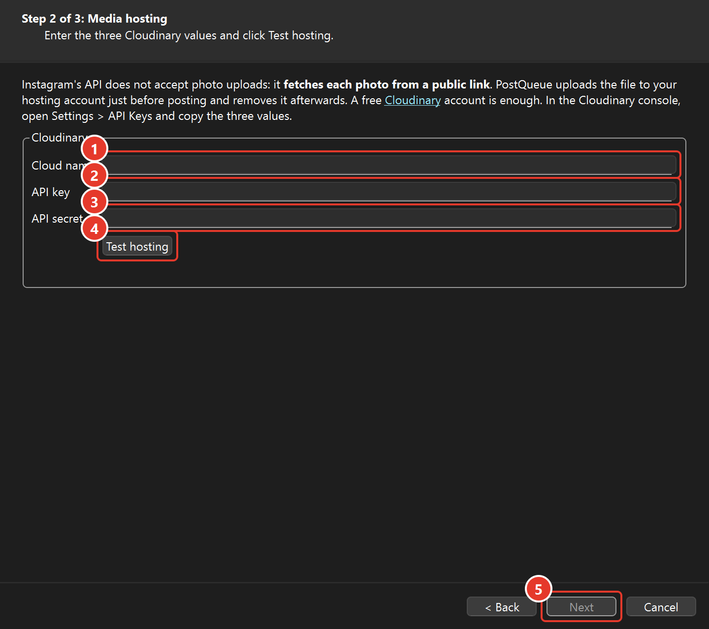
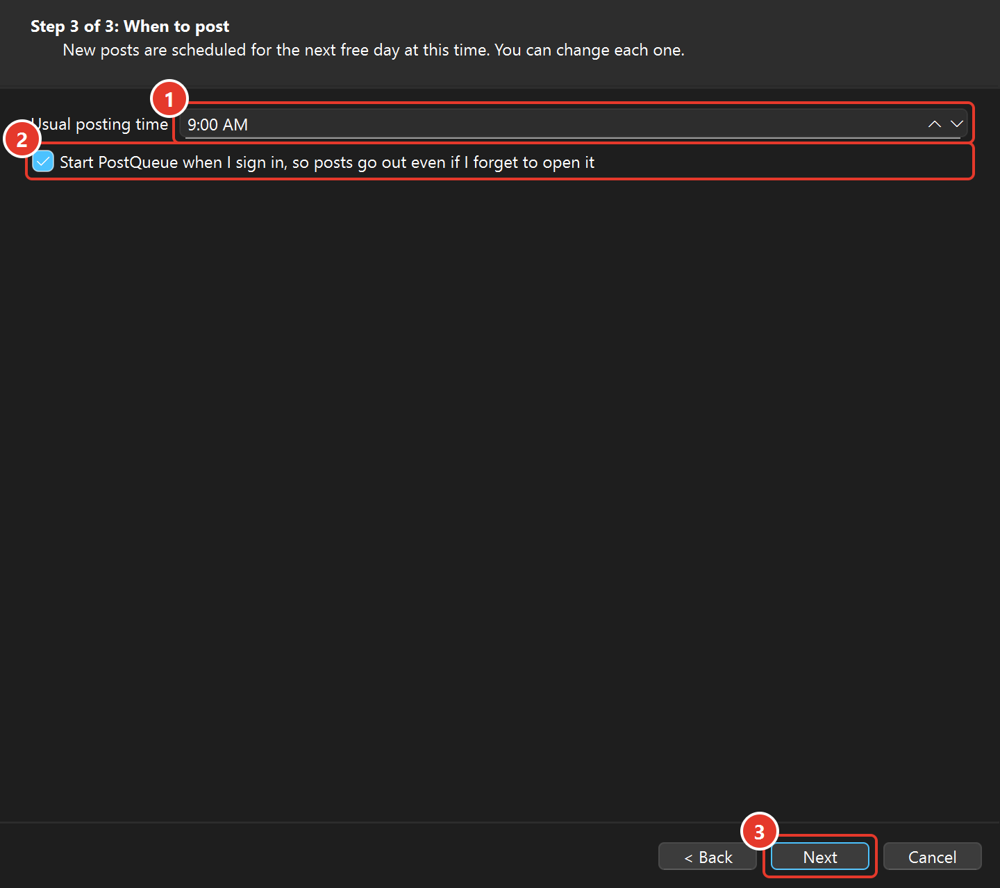
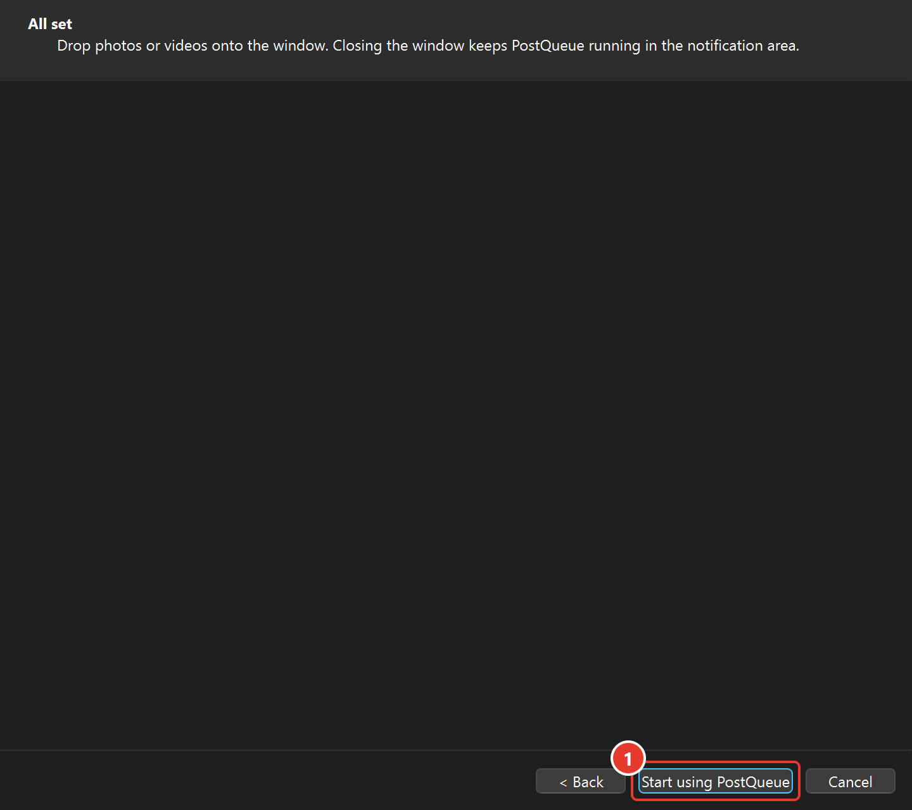
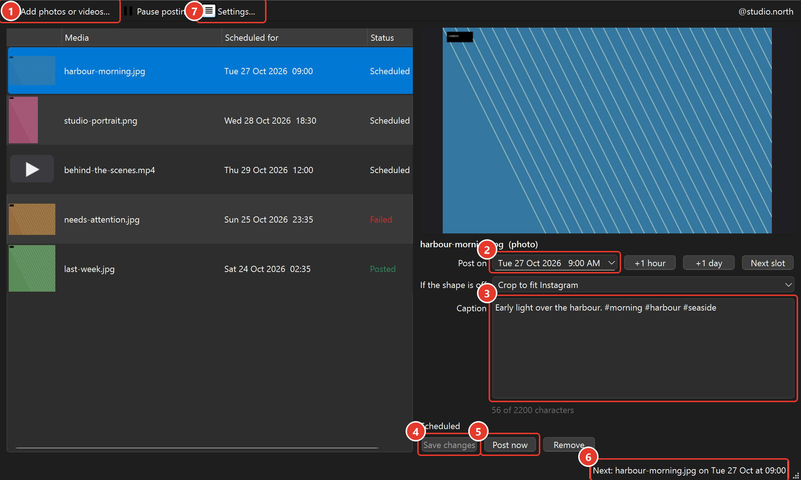

# PostQueue user guide

PostQueue posts your photos and videos to Instagram at the dates and times you choose. After a one-time setup, all you do is add files, pick when each one should go out, and write the caption.

## 1. Install

**Windows:** open `PostQueue-1.0.0-x64.msi` (or `-arm64` on an ARM PC) and click **Install**. That is the only screen. No administrator rights are needed. The installer adds a Start menu shortcut and starts PostQueue at sign-in, so scheduled posts go out even if you forget to open it. (The portable `.exe` works too; it just has no shortcut or start-at-sign-in entry until you turn that on in Settings.)

**Mac:** open `PostQueue-1.0.0-macos-arm64.dmg` (Apple silicon) or `-x86_64.dmg` (Intel) and drag PostQueue onto the Applications folder shown next to it. If the build is not signed, the first launch needs a right-click > Open. Tick **Start PostQueue when I sign in** in the setup steps so posts go out on time.

Closing the window keeps PostQueue running in the notification area on Windows (the icons next to the clock) or the menu bar on a Mac. Use the icon's menu to pause posting or quit.

## 2. One-time setup

The first time PostQueue opens, it walks you through setup **one step per screen**: Instagram account, media hosting, posting time. Next only lights up when the step is done, and everything can be changed later in **Settings** (the gear in the toolbar).

**What to do:** read the three steps, then click **Next** (1).

If you close the steps early, the yellow bar at the top of the window says what is still missing, and its button (1) takes you back to them:

PostQueue uses Meta's official Instagram API, which has three requirements.

### 2.1 An Instagram professional account

Instagram only allows API posting for **Business** or **Creator** accounts. In the Instagram app: Settings > Account type and tools > Switch to professional account. It is free and can be switched back.

For the simplest sign-in (**Facebook Login**), also link the account to a Facebook Page: Instagram > Settings > Business tools and controls > Connect a Facebook Page (create a Page if you have none). If you prefer not to involve Facebook, use **Instagram Login** (section 2.3).

### 2.2 A Meta app (for the sign-in)

This is a registration that gives PostQueue permission to post as you. It takes about ten minutes and is free.

1. Go to <https://developers.facebook.com/apps/> and sign in with the Facebook account that manages your Page (or any Facebook account, for Instagram Login). Create an app: choose the **Business** type (or, when offered, the "Instagram" use case).
2. In the app's dashboard, add the **Instagram** product (Instagram Graph API / Instagram API).
3. Under **App settings > Basic**, note the **App ID** and **App secret**.
4. Under **Facebook Login > Settings** (or Instagram > API setup with Instagram login > Business login settings), add this to **Valid OAuth Redirect URIs**:
   `http://localhost:48215/`
5. Keep the app in **Development mode**. In development mode the app may be used by the people listed under **App roles**: add yourself as an administrator or tester, and for Instagram Login add the Instagram account under **Instagram testers** (then accept the invitation in the Instagram app: Settings > Apps and websites > Tester invites). Development mode is enough for your own accounts; publishing the app with App Review is only needed if other people will use it.

### 2.3 Sign in (step 1 of 3)

**What to do, in order:**

1. Choose the sign-in type: **Facebook Login** (account linked to a Page) or **Instagram Login** (account only).
2. Enter the **Meta app ID** from the app dashboard (section 2.2).
3. Enter the **Meta app secret**. It lets the sign-in last 60 days; without it, a Facebook sign-in lasts about two hours. Instagram Login always needs it.
4. Click **Sign in in the browser**. Approve the request in the browser, then come back to PostQueue.
5. **Instead of 1 to 4**, you can paste an access token here and click **Check token**: a Meta Business Suite **system user** token (which never expires) or a token from the Graph API Explorer with the `instagram_basic` and `instagram_content_publish` permissions.
6. The account appears under **Post as**. If several Pages have Instagram accounts, choose the one to post to.
7. **Next** lights up. Click it.

If the browser ends on a page that cannot be displayed, copy the `code=…` part of its address into the box under the sign-in button and click **Use code**.

The same panel is in Settings > **Instagram** afterwards, with a **Disconnect** button.

When a sign-in is about to expire, the yellow bar tells you a week ahead. Instagram Login sign-ins are renewed automatically while PostQueue runs.

### 2.4 Media hosting (step 2 of 3)

Instagram's API does not accept photo uploads: it **fetches each photo from a public link**. PostQueue uploads each file to your own hosting account just before posting and deletes it afterwards.

First, get the three values:

- Create a free account at <https://cloudinary.com/users/register_free> (the free plan is far more than a personal queue needs).
- In the Cloudinary console, open **Settings > API Keys** (or the dashboard's "Product environment credentials") and copy the **Cloud name**, **API key** and **API secret**.

**What to do, in order:**

1. Paste the **Cloud name**.
2. Paste the **API key**.
3. Paste the **API secret**.
4. Click **Test hosting**. It uploads a tiny test image and removes it again, and says "Hosting works".
5. Click **Next**.

### 2.5 When to post (step 3 of 3)

**What to do:**

1. Pick your **usual posting time**. Each photo you add later is scheduled for the next free day at this time (you can change any of them).
2. Leave **Start PostQueue when I sign in** ticked, so posts go out even if you forget to open it.
3. Click **Next**, then **Start using PostQueue** on the last screen.

### 2.6 Settings > General (later changes)

- **Start PostQueue when I sign in:** the Windows installer turns this on; on a Mac, the setup steps ask. Needed for posts to go out on time. On Windows, turning it off here is the same as disabling "PostQueue Startup" in Task Manager's Startup apps; on a Mac it adds or removes a login item (a LaunchAgent). (With the portable EXE, tick it here.)
- **Default posting time for new posts:** each file you add is scheduled for the next free day at this time.
- **If the PC was off at the scheduled time, still post within…:** 12 hours by default. A post that is later than that is marked **Missed** instead of going out at an odd time; you can reschedule it or post it now.
- **Photos outside Instagram's shape range:** Instagram accepts photos between 4:5 (portrait) and 1.91:1 (landscape). Others are cropped (centred) or given white borders. You can change this per photo.

## 3. Daily use

**What to do:**

1. **Add photos or videos** (this button, Ctrl+O, or drag files onto the window). Photos: JPG, PNG, WEBP, BMP, TIFF, GIF. Videos: MP4 or MOV (H.264 with AAC audio works best), up to 1 GB. Each file appears in the list with the **next free posting time** already filled in.
2. With a file selected, pick the **date and time**: click the arrow for a calendar, or use **+1 hour**, **+1 day** and **Next slot**.
3. Write the **caption**, with #hashtags and @mentions. The counter under it warns when the caption is too long or has more than 30 hashtags.
4. Click **Save changes** (Ctrl+S). The row's **Scheduled for** column updates.
5. **Post now** publishes the selected post immediately instead of waiting. **Remove** takes it out of the queue (posts already on Instagram stay there).
6. The status bar shows the **next post**. Leave PostQueue running: closing the window keeps it in the notification area or menu bar. At the scheduled minute the post goes out, the row turns **Posted**, and **Open on Instagram** shows it.
7. **Settings** is for later changes to the account, hosting and posting time.

PostQueue keeps its own copy of each file, so you can move or delete the originals after adding them.

## 4. What Instagram allows

- About 50 posts per account per 24 hours through the API (PostQueue reports the limit's error if it is reached).
- Photos: JPEG, 4:5 to 1.91:1, up to 8 MB. PostQueue converts and resizes automatically.
- Videos are posted as **Reels**: MP4/MOV, 3 seconds to 15 minutes, 9:16 recommended, up to 1 GB. Instagram processes the video after upload, which can take a few minutes.
- Captions: up to 2,200 characters, 30 hashtags, 20 @mentions.
- Single photos and videos only; carousels (several photos in one post) and Stories are not in this version.

## 5. If something goes wrong

- **A row says Failed.** Select it to read why. Typical causes: the sign-in expired (sign in again in Settings), hosting details are wrong (Test hosting), or Instagram rejected the file (a video in an unsupported format). Fix the cause, then **Post now** or change the time and **Save changes**.
- **A row says Missed.** The PC was off or PostQueue was not running at the scheduled time, and the grace period passed. Reschedule it or post it now.
- **Temporary problems** (no connection, Instagram busy) are retried three times, five minutes apart, before a post is marked Failed.
- **Where is everything?** Settings > General > Open the data folder: the queue, media copies, settings and `postqueue.log`.

Removing PostQueue (Windows Settings > Installed apps, or dragging the app to the Bin on a Mac) removes the program. The data folder stays; delete `%LOCALAPPDATA%\PostQueue` on Windows or `~/Library/Application Support/PostQueue` on a Mac to remove the queue and the sign-in. On a Mac, the Instagram token and hosting secret are in the login keychain (items named "PostQueue …") and the login item is `~/Library/LaunchAgents/com.postqueue.app.plist`.
