# PostQueue user guide

PostQueue posts your photos and videos to Instagram at the dates and times you choose. After a one-time setup, all you do is add files, pick when each one should go out, and write the caption.

## 1. Install

**Windows:** open `PostQueue-1.0.0-x64.msi` (or `-arm64` on an ARM PC) and click **Install**. That is the only screen. No administrator rights are needed. The installer adds a Start menu shortcut and starts PostQueue at sign-in, so scheduled posts go out even if you forget to open it. (The portable `.exe` works too; it just has no shortcut or start-at-sign-in entry until you turn that on in Settings.)

**Mac:** open `PostQueue-1.0.0-macos-arm64.dmg` (Apple silicon) or `-x86_64.dmg` (Intel) and drag PostQueue onto the Applications folder shown next to it. If the build is not signed, the first launch needs a right-click > Open. Tick **Start PostQueue when I sign in** in the setup steps so posts go out on time.

Closing the window keeps PostQueue running in the notification area on Windows (the icons next to the clock) or the menu bar on a Mac. Use the icon's menu to pause posting or quit.

## 2. One-time setup

The first time PostQueue opens, it walks you through setup **one screen at a time**: three short screens, each with one thing to do and one button. Everything can be changed later in **Settings** (the gear in the toolbar).

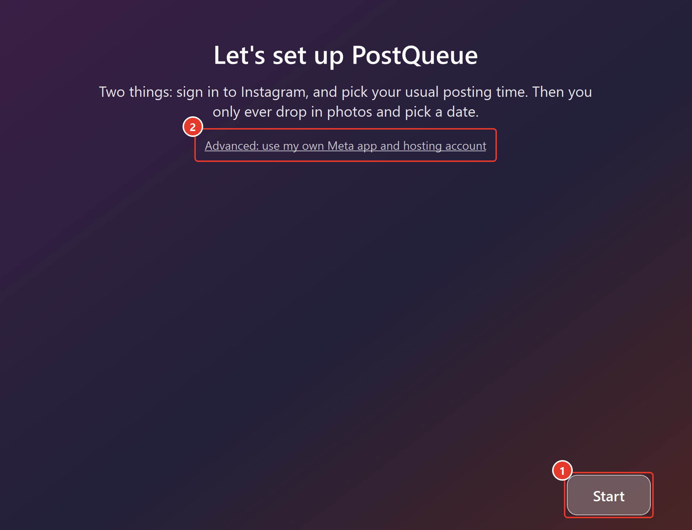

**Press Start** (1). (**Advanced** (2) is for people who want to use their own Meta app and hosting account; see section 3.)

If you close the steps early, the yellow bar at the top of the window says what is still missing, and its button (1) takes you back to them:

### 2.1 Use a professional Instagram account

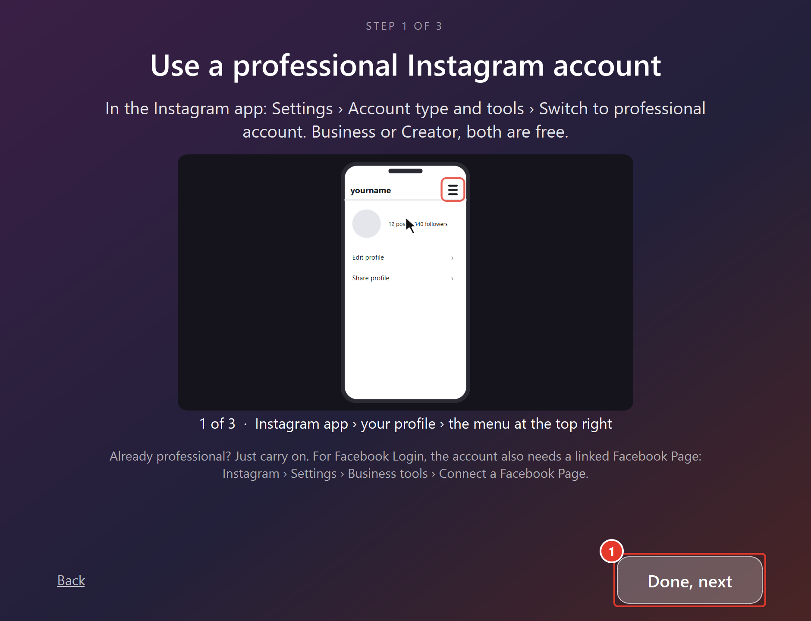

Instagram only allows posting through its API for **Business** or **Creator** accounts. In the Instagram app: Settings › Account type and tools › Switch to professional account. It is free and can be switched back. The screen plays a short demo of the Instagram app with the pointer moving to each thing to tap; it replays until you move on, and a click on it skips ahead. For Facebook Login, the account also needs a linked Facebook Page: Instagram › Settings › Business tools and controls › Connect a Facebook Page (create a Page if you have none). Press **Done, next** (1).

### 2.2 Sign in

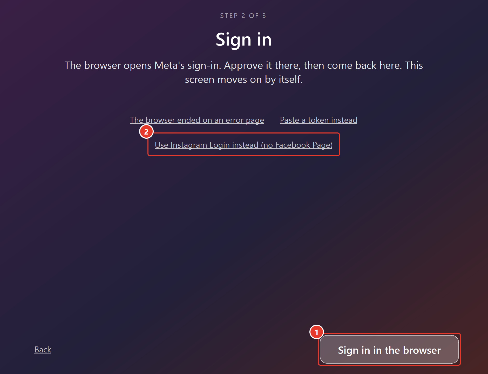

Press **Sign in in the browser** (1). The browser opens Meta's sign-in: approve PostQueue there, then come back. The screen says "Connected as @yourname" and moves on by itself. If several Pages have Instagram accounts, one extra screen asks which one to post as.

**Use Instagram Login instead** (2) is for an Instagram account that is not linked to a Facebook Page. If the browser ends on an error page, press **The browser ended on an error page**, paste the `code=…` part of its address, and press Enter.

### 2.3 When to post

Pick your **usual posting time** (1) and press **Next** (2). Each photo you add later is scheduled for the next free day at this time; you can change any of them. PostQueue also starts when you sign in to your computer, so posts go out even if you forget to open it (Settings › General turns that off).

Press **Start using PostQueue** (1).

Photos are hosted for the moment it takes Instagram to fetch them by the PostQueue service, then removed. Nothing to set up.

### 2.4 Settings > General (later changes)

- **Start PostQueue when I sign in:** the Windows installer turns this on; on a Mac, the setup steps ask. Needed for posts to go out on time. On Windows, turning it off here is the same as disabling "PostQueue Startup" in Task Manager's Startup apps; on a Mac it adds or removes a login item (a LaunchAgent). (With the portable EXE, tick it here.)
- **Default posting time for new posts:** each file you add is scheduled for the next free day at this time.
- **If the PC was off at the scheduled time, still post within…:** 12 hours by default. A post that is later than that is marked **Missed** instead of going out at an odd time; you can reschedule it or post it now.
- **Photos outside Instagram's shape range:** Instagram accepts photos between 4:5 (portrait) and 1.91:1 (landscape). Others are cropped (centred) or given white borders. You can change this per photo, and the preview shows what will be cut off or where the borders go.

## 3. Advanced setup: your own Meta app and hosting

This is the path PostQueue takes when it was built without a built-in Meta app and service (see the build guide), or when you press **Advanced** on the welcome screen because you want to use your own. Each screen still asks for one thing, but there are about fifteen of them, and they include creating a Meta app and a Cloudinary account. About fifteen minutes.

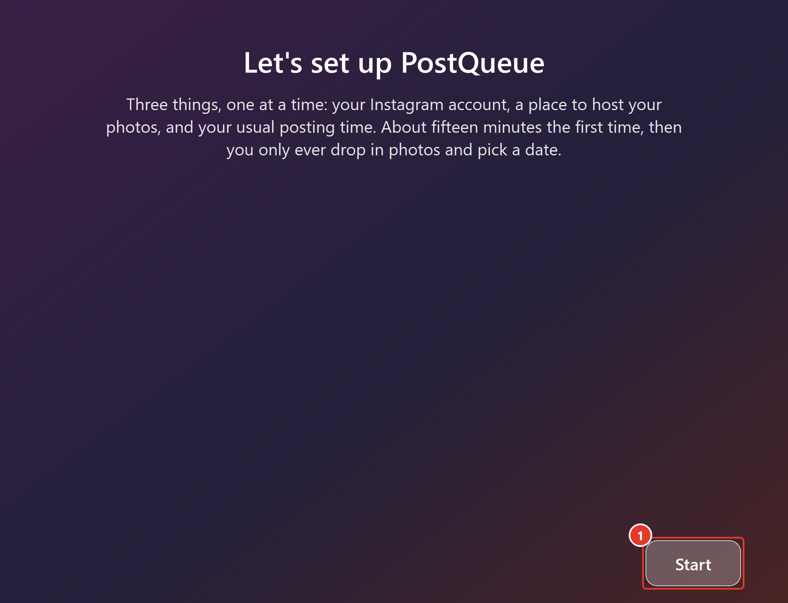

**Press Start** (1).

If you close the steps early, the yellow bar at the top of the window says what is still missing, and its button (1) takes you back to them:

### 3.1 Your Instagram account

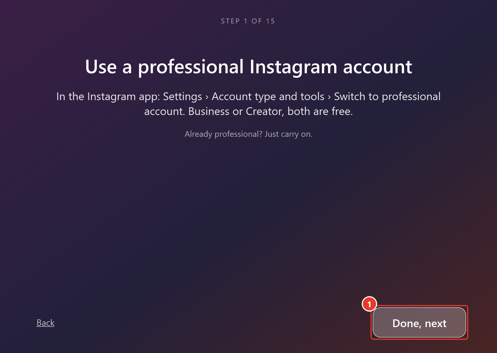

Instagram only allows posting through its API for **Business** or **Creator** accounts. In the Instagram app: Settings › Account type and tools › Switch to professional account. It is free and can be switched back. Then press **Done, next** (1).

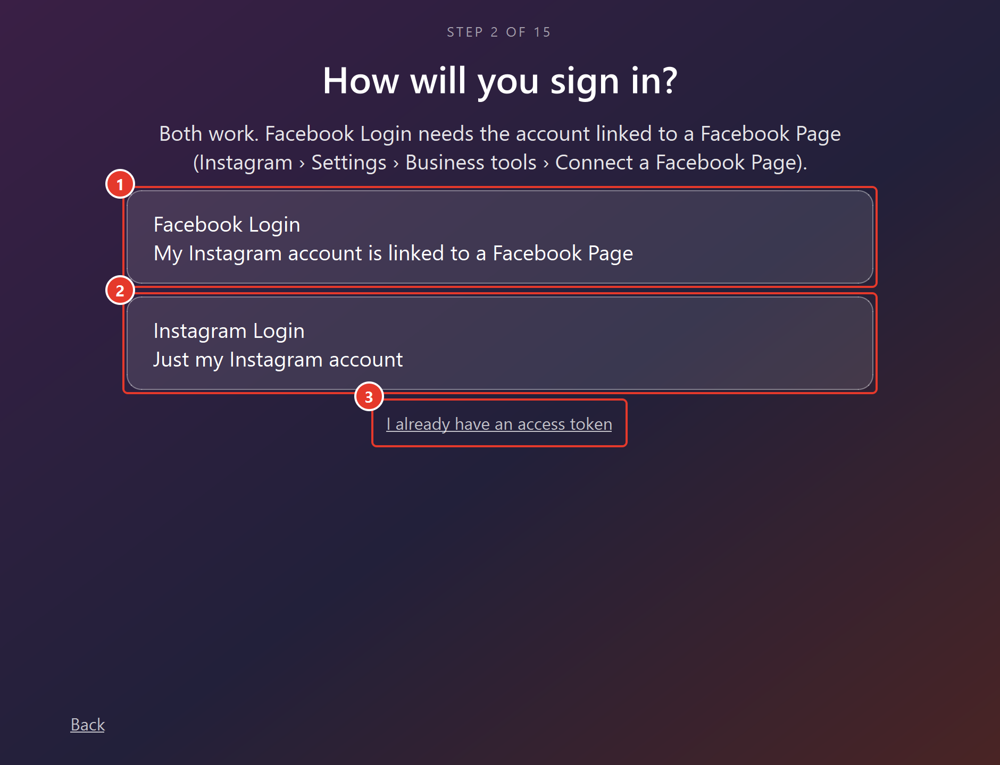

Pick one:

1. **Facebook Login** if your Instagram account is linked to a Facebook Page (Instagram › Settings › Business tools and controls › Connect a Facebook Page; create a Page if you have none).
2. **Instagram Login** if you want to keep Facebook out of it.
3. **I already have an access token** skips the Meta app screens: for a Meta Business Suite system-user token (never expires) or a Graph API Explorer token with `instagram_basic` and `instagram_content_publish`.

### 3.2 The Meta app (five short screens)

A Meta app is a free registration that lets PostQueue post as you. The screens take you through it one value at a time, and each one plays a looping demo of the Meta page it is talking about: a drawing of the page with the pointer moving to the button or menu to click, a click ripple, and a caption ("2 of 5 · My Apps"). It replays until you move on; a click on the demo skips to its next frame.

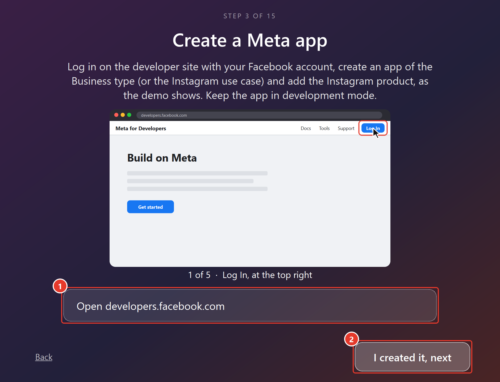

Press **Open developers.facebook.com** (1). Use **Log In** at the top right with your Facebook account (the page says "not found" if you go straight to the apps list while logged out), then open **My Apps**, click **Create app**, choose the **Business** type (or the "Instagram" use case when offered) and add the **Instagram** product, exactly as the demo on the screen shows, frame by frame. Keep the app in development mode. Then press **I created it, next** (2).

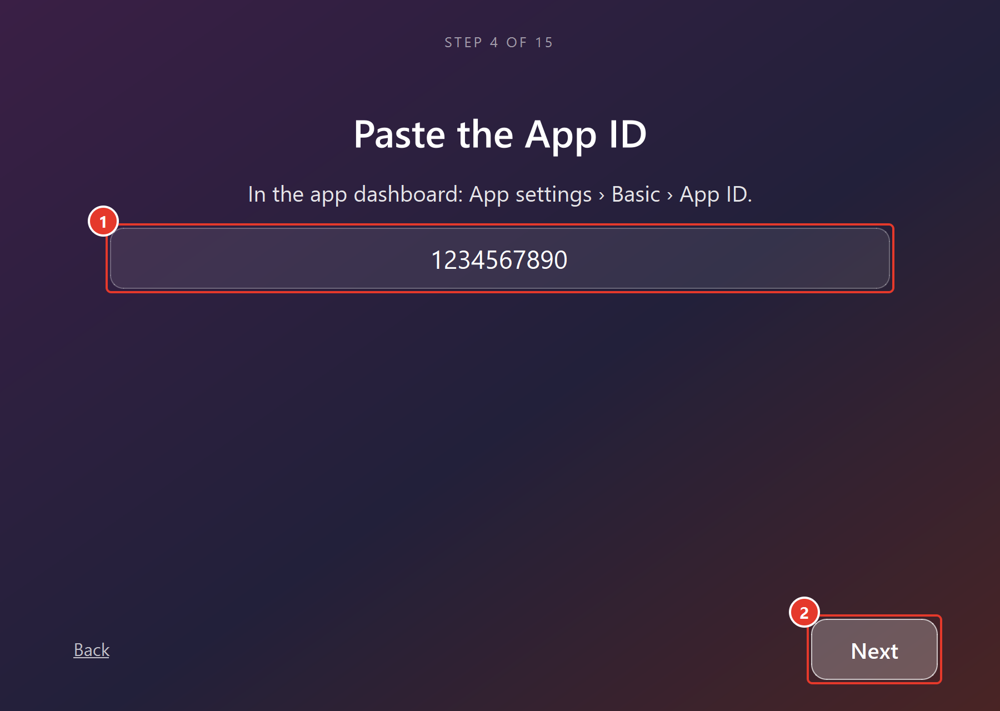

In the app dashboard: **App settings › Basic**. Copy the **App ID** into the box (1) and press **Next** (2). Next only lights up once something is in the box, and PostQueue then checks the ID with Meta: a public app shows its name; an app still in development mode is private to that lookup and is confirmed on the next screen together with the secret.

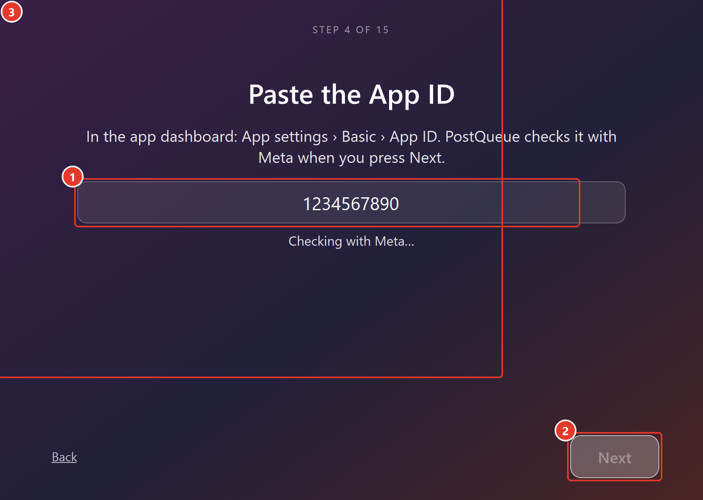

Same page: **App secret** (click Show). Paste it (1) and press **Next** (2). PostQueue proves the ID and secret belong together before moving on, and says so if they don't. With the secret, the sign-in lasts 60 days and renews. For Facebook Login you may **Skip this** (3), but the sign-in then lasts about two hours. Instagram Login always needs it.

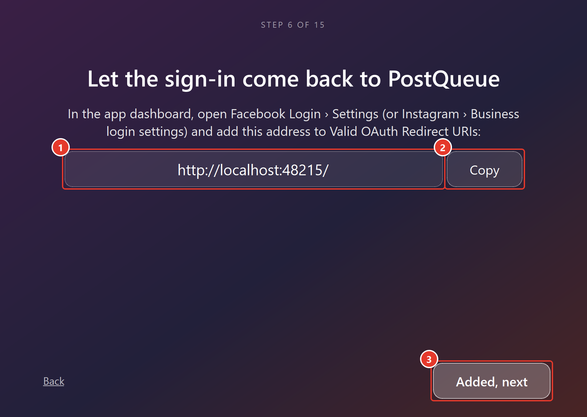

In the dashboard open **Facebook Login › Settings** (or **Instagram › Business login settings**) and add the address shown (1) to **Valid OAuth Redirect URIs**. **Copy** (2) puts it on the clipboard. Then press **Added, next** (3).

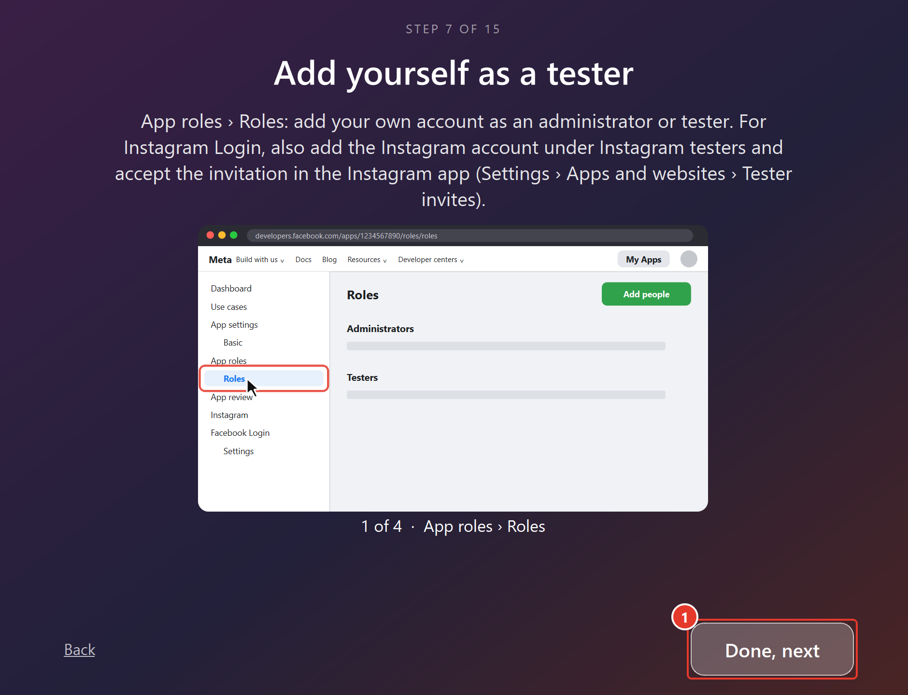

**App roles › Roles**: add your own account as an administrator or tester. For Instagram Login, also add the Instagram account under **Instagram testers**, then accept the invitation in the Instagram app (Settings › Apps and websites › Tester invites). Press **Done, next** (1). Development mode is enough for your own accounts; App Review is only needed if other people will use your app.

### 3.3 Sign in

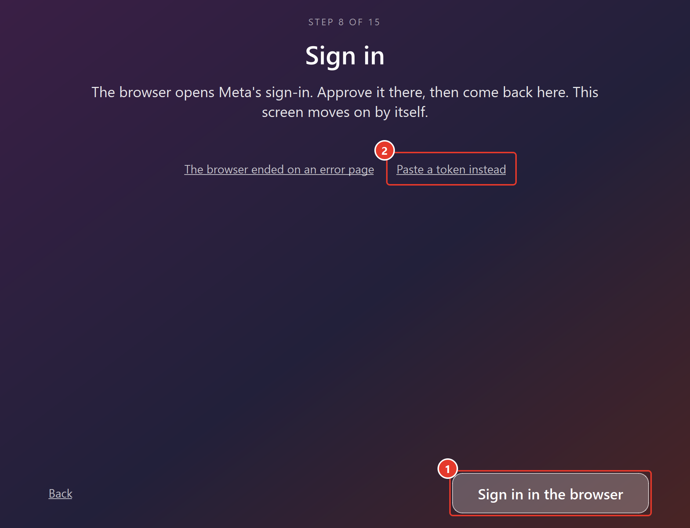

Press **Sign in in the browser** (1). Approve Meta's request in the browser, then come back: the screen says "Connected as @yourname" and moves on by itself. If several Pages have Instagram accounts, one extra screen asks which one to post as.

If the browser ends on an error page, press **The browser ended on an error page**, paste the `code=…` part of its address, and press Enter. **Paste a token instead** (2) switches to the token screen.

### 3.4 Media hosting (four short screens)

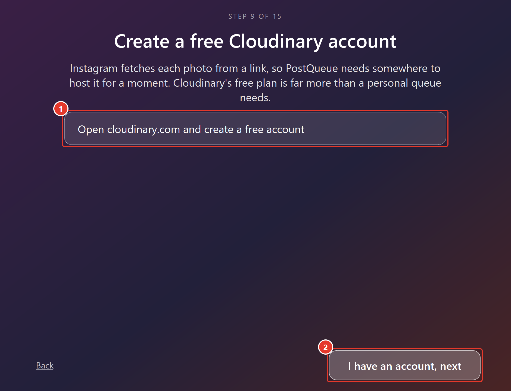

Instagram fetches each photo **from a link**, so PostQueue needs somewhere to host it for a moment. Press **Open cloudinary.com** (1) and create a free account (the free plan is far more than a personal queue needs). Then press **I have an account, next** (2). The next three screens each play a demo of the Cloudinary console page where the value lives (Settings › API Keys), with the pointer on the field to copy.

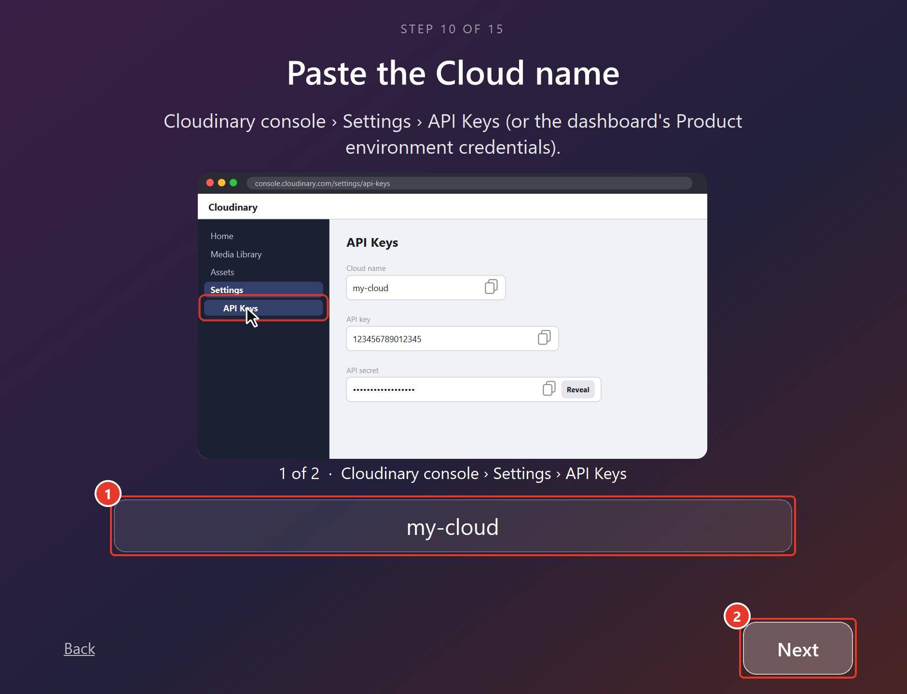

In the Cloudinary console open **Settings › API Keys** (or the dashboard's "Product environment credentials"). The next three screens each take one value: **Cloud name** (1, then Next 2), **API key**, **API secret**.

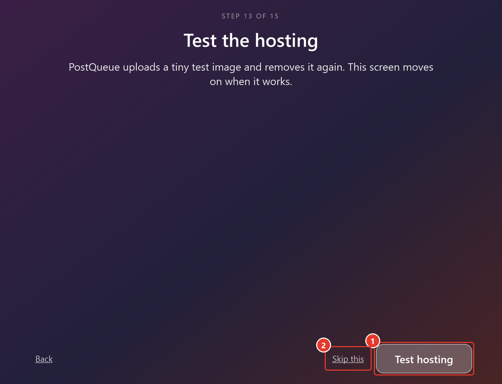

Press **Test hosting** (1). PostQueue uploads a tiny test image, removes it, says "Hosting works", and moves on. If it fails, the screen says why; **Skip this** (2) lets you carry on and test later in Settings.

### 3.5 When to post

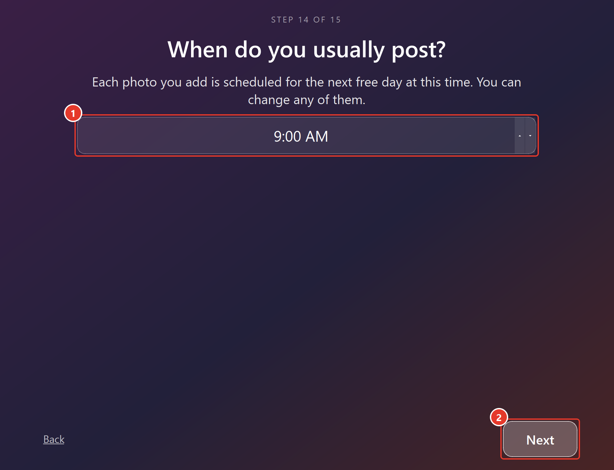

Pick your **usual posting time** (1) and press **Next** (2). Each photo you add later is scheduled for the next free day at this time; you can change any of them.

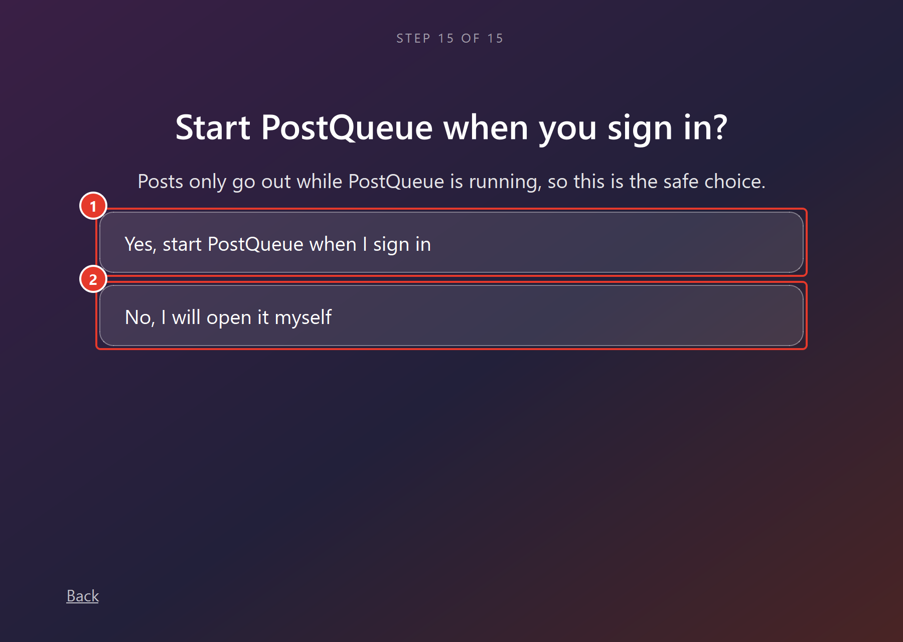

Press **Yes, start PostQueue when I sign in** (1). Posts only go out while PostQueue is running, so this is the safe choice; **No** (2) means you open it yourself.

Press **Start using PostQueue** (1).

## 4. Daily use

**What to do:**

1. **Add photos or videos** (this button, Ctrl+O, or drag files onto the window). Photos: JPG, PNG, WEBP, BMP, TIFF, GIF. Videos: MP4 or MOV (H.264 with AAC audio works best), up to 1 GB. Each file appears in the list with the **next free posting time** already filled in.
2. With a file selected, pick the **date and time**: click the date to open a calendar and pick a day, set the time next to it, or use **+1 hour**, **+1 day**, **+1 week** and **Next free slot** underneath.

   
3. Write the **caption**, with #hashtags and @mentions. The counter under it warns when the caption is too long or has more than 30 hashtags.
4. Click **Save changes** (Ctrl+S). The row's **Scheduled for** column updates.
5. **Post now** publishes the selected post immediately instead of waiting (it asks first). **Remove** takes it out of the queue (posts already on Instagram stay there).
6. The status bar shows the **next post**. Leave PostQueue running: closing the window keeps it in the notification area or menu bar. At the scheduled minute the post goes out, the row turns **Posted**, and **Open on Instagram** shows it.
7. **Settings** is for later changes to the account, hosting and posting time.

PostQueue keeps its own copy of each file, so you can move or delete the originals after adding them.

### 4.1 More than a single photo

- **Carousels.** Add several files at once and PostQueue asks: **One post each**, or **One carousel post** (2 to 10 photos or videos, swiped through on Instagram). To turn an existing post into a carousel, press **Add another photo or video** under **In this post**; select a thumbnail there and press **Remove selected** to take one out. The caption applies to the whole carousel; videos inside a carousel are posted as videos, not Reels.
- **Stories.** Set **Post as** to **Story**. The photo or video goes out as a story: shaped 9:16 (the preview shows the crop or borders), with no caption, gone after 24 hours.
- **First comment.** Text posted as the first comment right after publishing. Many people keep their hashtags here so the caption stays clean. If Instagram refuses the comment, the post still counts as posted and the confirmation says the comment was not added.
- **Alt text** (photos): a short description for people who cannot see the picture; Instagram also uses it for search.
- **Cover at** (videos): the second of the video that becomes its cover picture.

### 4.2 Drafts, copies and whole plans

- **Draft.** Tick **Draft: keep, do not post yet** and save. The post stays in the queue marked Draft and never goes out until you untick it and save again. Useful for a caption you are still writing.
- **Duplicate.** Makes a copy of the selected post, with its photos and all its settings, scheduled for the next free slot. Change what differs and save.
- **Add from a sheet.** For a whole month at once: a CSV file with the columns `file`, `date`, `time`, `caption`, `first_comment`, `alt_text`, `target`. Only `file` is required; paths are relative to the sheet; `date` is `2027-05-01` and `time` is `18:30` (missing date means the next free slot, missing time means your usual time); `target` is `story` for a story; several files separated by `|` in one `file` cell make a carousel. Rows that cannot be added are listed afterwards, and the rest go in.

### 4.3 New versions

On start, PostQueue looks once at its Releases page. When a newer version exists, a blue strip at the top says so, with a **Download** button. Settings › General turns the check off.

## 5. What Instagram allows

- About 50 posts per account per 24 hours through the API (PostQueue reports the limit's error if it is reached).
- Photos: JPEG, 4:5 to 1.91:1, up to 8 MB. PostQueue converts and resizes automatically.
- Videos are posted as **Reels**: MP4/MOV, 3 seconds to 15 minutes, 9:16 recommended, up to 1 GB. PostQueue checks the length and shape as you add the file and says so under the preview. Instagram processes the video after upload, which can take a few minutes.
- Captions: up to 2,200 characters, 30 hashtags, 20 @mentions.
- Carousels: 2 to 10 photos or videos; Stories: one photo or video at 9:16, no caption. Collaborative posts, product tags and location tags are not in this version.

## 6. If something goes wrong

- **A row says Failed.** Select it to read why. Typical causes: the sign-in expired (sign in again in Settings), hosting details are wrong (Test hosting), or Instagram rejected the file (a video in an unsupported format). Fix the cause, then **Post now** or change the time and **Save changes**.
- **A row says Missed.** The PC was off or PostQueue was not running at the scheduled time, and the grace period passed. Reschedule it or post it now.
- **Temporary problems** (no connection, Instagram busy) are retried three times, five minutes apart, before a post is marked Failed.
- **Where is everything?** Settings > General > Open the data folder: the queue, media copies, settings and `postqueue.log`.

Removing PostQueue (Windows Settings > Installed apps, or dragging the app to the Bin on a Mac) removes the program. The data folder stays; delete `%LOCALAPPDATA%\PostQueue` on Windows or `~/Library/Application Support/PostQueue` on a Mac to remove the queue and the sign-in. On a Mac, the Instagram token and hosting secret are in the login keychain (items named "PostQueue …") and the login item is `~/Library/LaunchAgents/com.postqueue.app.plist`.
